# Claude 잔액 키트 설치 안내 (맥)

> 그림이 더 크게 나오는 웹 안내서 : **https://kongsak-kr.github.io/claude-balance-kit/**

맥에서 **한 줄만 붙여 넣으면** 설치가 시작되고, 그다음은 터미널에 나오는 안내를 하나씩 따라 하면 돼요. 10분쯤 걸려요.

**설치가 끝나면**
- 크롬 오른쪽 위 **$ 아이콘**을 누르면 Anthropic(Claude) 크레딧 **잔액**이 바로 보여요.
- 바탕화면의 **OpenCode 열기**로 코딩 도우미 OpenCode 를 쓸 수 있어요.

**시작하기 전에 준비할 것**
- 맥 (아이맥 · 맥북 모두 돼요)
- 구글 크롬 — 없으면 설치 중에 안내해 드려요
- Anthropic 콘솔(platform.claude.com) 로그인 정보 — 크롬에서 미리 로그인해 두면 더 편해요

---

## 1. 터미널 열기

터미널은 맥에 원래 들어 있는 프로그램이에요. 글자로 명령을 넣는 창이에요.

1. 키보드에서 `⌘ command` 를 누른 채 `스페이스` 를 누르세요.
2. 가운데 검색 창이 뜨면 **터미널** 이라고 입력하세요.
3. `return`(엔터) 키를 누르세요.

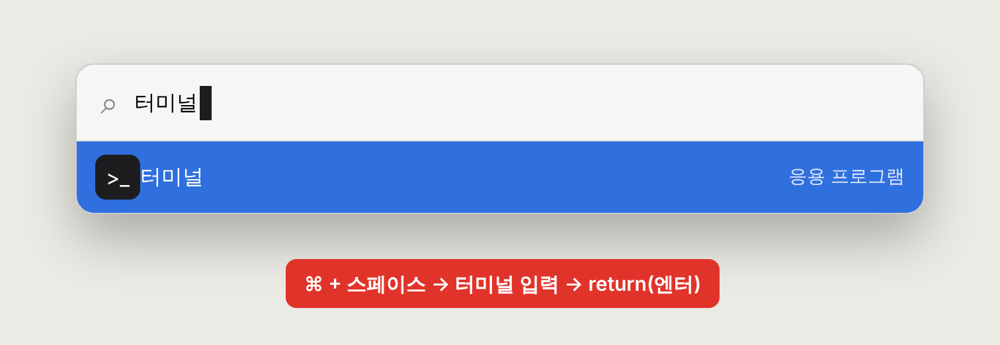

## 2. 설치 명령 붙여 넣기

1. 아래 한 줄을 복사하세요. (웹 안내서에는 **복사하기** 버튼이 있어요)
2. 터미널 창을 한 번 누르고 `⌘` + `V` (붙여넣기)
3. `return`
4. 「준비되면 엔터를 누르세요」가 나오면 한 번 더 `return`

```
curl -fsSL https://raw.githubusercontent.com/KongSak-Kr/claude-balance-kit/main/install.sh | bash
```

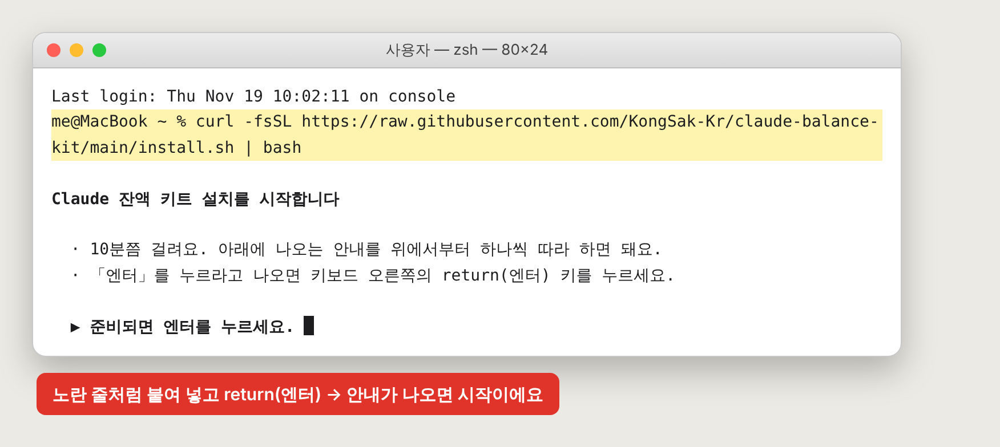

> **이제부터는 터미널이 안내해요.** 터미널에 나오는 글을 위에서부터 읽고, 「엔터를 누르세요」가 나오면 할 일을 한 뒤 `return` 을 누르면 돼요. 이 안내서는 그림이 필요할 때 보는 곳이에요.

## 3. API 키 넣기

OpenCode 가 Claude 를 쓰려면 「API 키」라는 열쇠가 필요해요. 터미널이 크롬에 키 만드는 화면(API keys)을 열어 줘요. 콘솔 화면은 영어라서 누를 버튼 이름을 영어 그대로 적었어요.

1. 로그인 화면이 나오면 먼저 로그인하세요.
2. 오른쪽 위 **Create key** 버튼을 누르세요.
3. Name(이름) 칸에 **OpenCode** 라고 쓰세요.
4. Workspace 를 고르는 칸이 있으면 **Default** 를 고르세요.
5. **Add** 버튼을 누르세요.
6. **sk-ant-api** 로 시작하는 긴 키가 나오면 옆의 **Copy** 를 누르세요.
7. 터미널 창을 한 번 누르고 `⌘` + `V` → `return`

> 붙여 넣어도 터미널에 **아무 글자도 안 보이는 게 정상**이에요. 비밀번호처럼 숨겨져요. 그대로 `return` 을 누르세요.

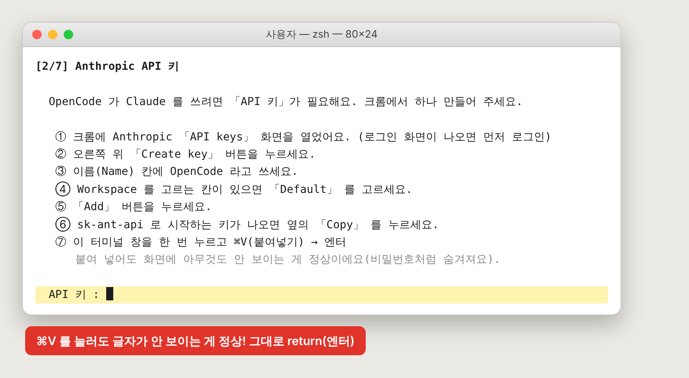

「키가 확인되었습니다」가 나오면 다음으로 넘어가요. 「키 오류」가 나오면 키를 다시 복사해서 붙여 넣으세요(3번까지 할 수 있어요).

## 4. 기다리기 (자동으로 설치돼요)

1. 「OpenCode 설치 중」 뒤에 점(.)이 찍히는 동안 1~2분 기다리세요.
2. 「맥을 켤 때 OpenCode 가 자동으로 켜지게 하고 … 아이콘을 만들까요?」가 나오면 그냥 `return` (예)
3. 「터미널이 데스크탑 폴더에 접근하려고 합니다」 창이 뜨면 **허용**

## 5. 크롬에 확장 넣기

터미널이 크롬에 「확장 프로그램」 화면을 열어 줘요. 화면이 안 보이면 크롬 맨 위 주소창을 누르고 `⌘` + `V` → `return` (주소를 복사해 뒀어요).

**① 개발자 모드 켜기** — 화면 오른쪽 위 **개발자 모드** 스위치를 눌러 켜세요. 파란색이 되면 켜진 거예요. 그다음 터미널로 돌아와 `return`.

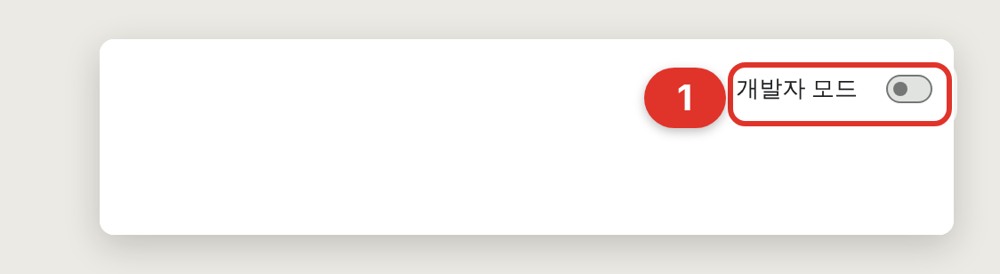

**② 압축해제된 확장 프로그램 로드** — 왼쪽 위에 새로 생긴 **압축해제된 확장 프로그램 로드** 버튼을 누르세요.

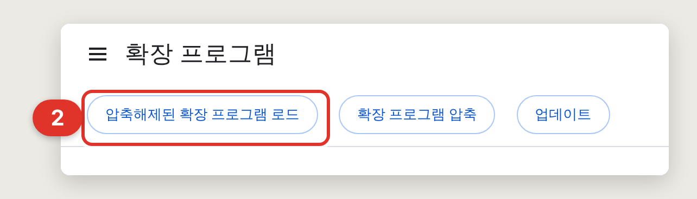

**③ 폴더 고르기**
1. 폴더를 고르는 창이 뜨면 `⌘` + `Shift` + `G` 세 개를 함께 누르세요.
2. 작은 입력 칸이 나오면 `⌘` + `V` → `return` (폴더 위치를 터미널이 복사해 뒀어요)
3. 창 오른쪽 아래 **선택** 을 누르세요.
4. 터미널로 돌아와 `return`.

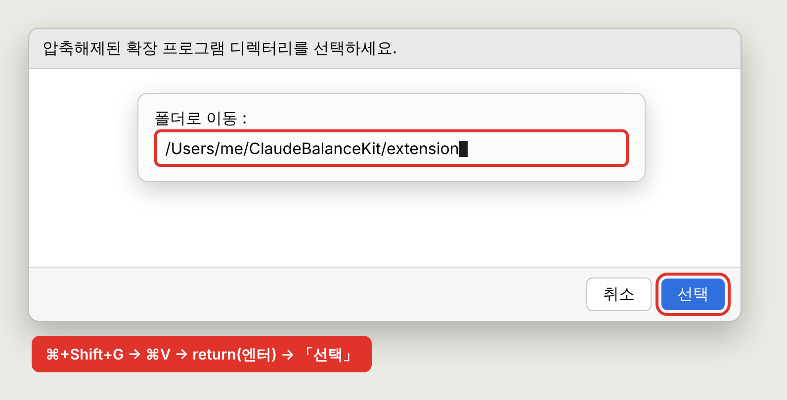

**④ 들어갔는지 보기** — 「확장 프로그램」 화면에 **Claude 잔액 키트** 카드가 생기면 성공이에요. 터미널도 스스로 확인해서 「✓ 크롬에 잘 들어갔어요!」라고 알려 줘요. 이때 「Claude 잔액 키트 설정」 탭이 하나 새로 열려요 — 지금은 그냥 두세요.

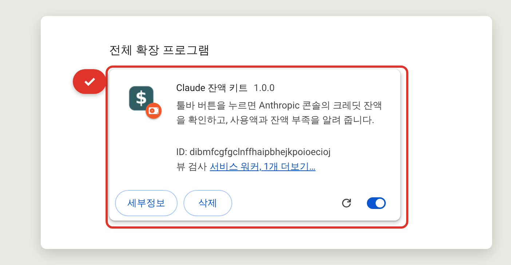

## 6. 툴바에 고정하기

1. 크롬 오른쪽 위, 주소창 끝의 **퍼즐 조각 모양** 아이콘을 누르세요.
2. 목록에서 「Claude 잔액 키트」 오른쪽의 **핀(압정)** 모양을 누르세요.
3. 주소창 오른쪽에 청록색 **$** 아이콘이 생기면 된 거예요. 터미널로 돌아와 `return`.

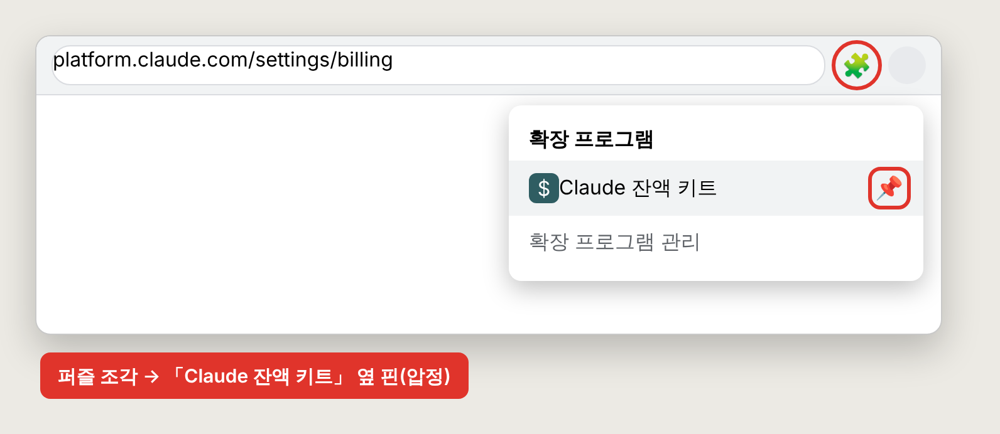

## 7. 잔액 확인해 보기

1. 터미널이 크롬에 결제(Billing) 화면을 열어 줘요. 로그인 화면이 나오면 로그인하세요.
2. 화면에 Credit balance(크레딧 잔액) 금액이 보이면, 주소창 오른쪽 **$** 아이콘을 누르세요.
3. 작은 창 맨 위에 잔액이 진한 글씨로 나오면 성공이에요. 터미널로 돌아와 `return`.

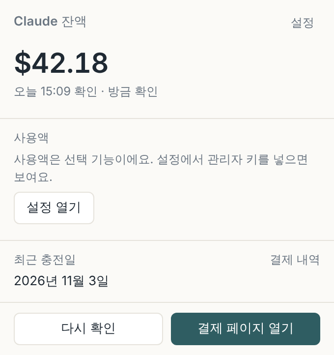

- 잔액을 확인할 때 결제 화면 탭이 잠깐 열렸다 닫혀요. 정상이에요.
- 다음 질문 「지금 관리자 키를 넣을까요?」는 잘 모르면 그냥 `return`. 그러면 설치가 끝나요.

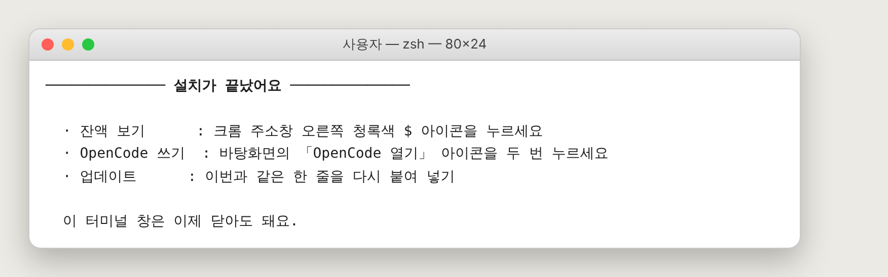

## 8. (선택) 관리자 키 — 사용액 · 잔액 부족 알림

오늘 · 이번 주 · 이번 달 **사용액**과 **잔액 부족 알림**까지 쓰고 싶을 때만 해요. Anthropic 콘솔의 **조직 관리자**만 만들 수 있어서, 잘 모르면 건너뛰어도 돼요. 잔액 보기는 이 단계 없이도 돼요.

1. 크롬에서 https://platform.claude.com/settings/admin-keys 를 여세요.
2. **Create admin key** → 이름 칸에 **잔액확장** → **Add**
3. **sk-ant-admin** 으로 시작하는 키 옆 **Copy**
4. 크롬의 「Claude 잔액 키트 설정」 탭으로 가세요. 없으면 **$** 아이콘 → 오른쪽 위 **설정**.
5. 「관리자 키」 칸(①)을 누르고 `⌘` + `V` → **연결 확인**(②)
6. 초록 글씨로 「연결됨」이 나오면 끝이에요.

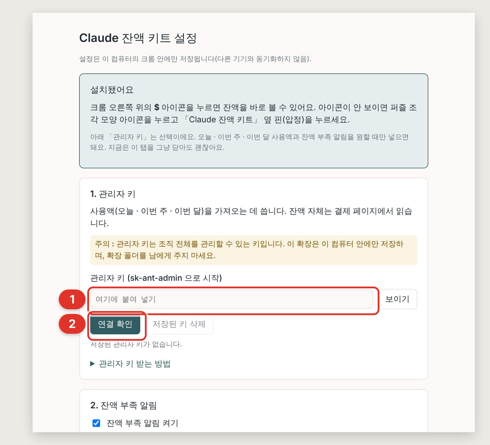

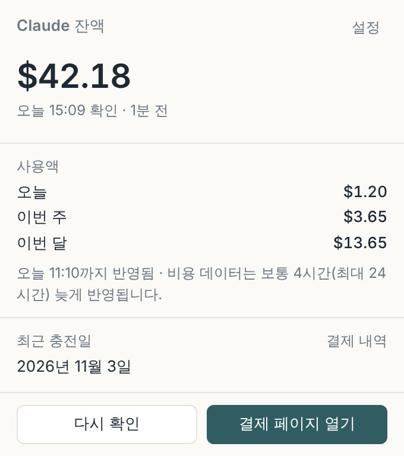

> 「개인(Individual) 계정은 만들 수 없다」는 안내가 나오면 이 단계는 그냥 넘어가세요.

---

## 매일 쓰는 법

- **잔액 보기** : 크롬 오른쪽 위 청록색 **$** 아이콘. 누를 때마다 새로 확인해요.
- **OpenCode 쓰기** : 바탕화면의 **OpenCode 열기** 아이콘을 두 번 누르세요.
- **잔액 부족 알림**(관리자 키를 넣은 경우) : 잔액이 $5 아래로 내려간 것 같으면 $ 아이콘에 작은 빨간 **!** 가 붙고 알림이 와요.

## 업데이트하기

1. 터미널을 열고(1단계) 설치 때와 **같은 명령**을 붙여 넣고 `return`.
2. 「API 키를 새로 넣을까요?」는 그냥 `return`.
3. 터미널 안내에 따라 크롬 「확장 프로그램」 화면에서 카드의 **동그란 화살표(↻)** 를 누르세요.

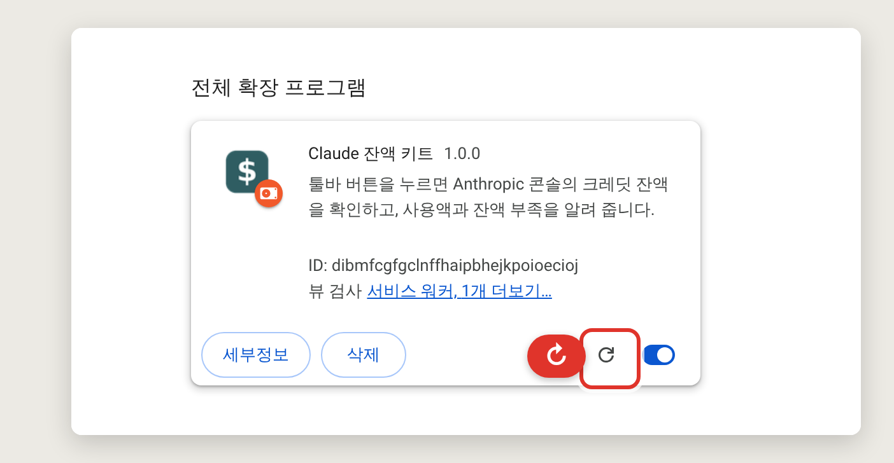

## 지우기

1. 터미널에 아래 명령을 붙여 넣고 `return`.

   ```
   bash ~/ClaudeBalanceKit/uninstall.sh
   ```

2. 질문에 답하세요(키와 OpenCode 를 지울지 물어봐요. 잘 모르면 그냥 `return`).
3. 크롬 「확장 프로그램」 화면에서 「Claude 잔액 키트」 카드의 **삭제**를 누르세요.

## 문제가 생기면

**터미널 창이 사라졌어요** — 화면 아래 Dock 에서 검은 네모 모양 「터미널」 아이콘을 누르세요. 크롬 창 뒤에 숨어 있을 때가 많아요.

**API 키를 붙여 넣었는데 아무것도 안 보여요** — 정상이에요. 그대로 `return`.

**「키 오류」가 나와요** — 키를 끝까지 복사하지 않았거나 지워진 키예요. 콘솔에서 **Create key** 로 새 키를 만들어 다시 붙여 넣으세요. 「관리자 키는 크롬 확장 설정에 넣는 키」라고 나오면 **sk-ant-admin** 키를 넣은 거예요. 설치에는 **sk-ant-api** 키를 넣으세요.

**「작업 공간(Workspace)이 정해지지 않은 키」라고 나와요** — 키를 만들 때 Workspace 칸에서 **Default** 를 골라 새로 만든 뒤 붙여 넣으세요.

**「확장 프로그램」 화면이 열리지 않아요** — 크롬 맨 위 주소창을 누르고 `⌘` + `V` → `return`. 안 되면 주소창에 `chrome://extensions` 라고 직접 쓰세요.

**폴더를 고르는 창에서 붙여 넣기가 안 돼요** — 터미널로 돌아가 `return` 을 누르면 확인 뒤 「r = 처음부터 다시 안내」가 나와요. `r` → `return` 을 누르면 폴더 위치를 다시 복사하고 처음부터 안내해 줘요. 직접 찾아가려면 창 왼쪽 집 모양(홈 폴더) → **ClaudeBalanceKit** → **extension** 을 한 번 누르고 **선택**.

**터미널이 계속 「아직 확인이 안 돼요」라고 해요** — 「확장 프로그램」 화면에 「Claude 잔액 키트」 카드가 보이면 잘 된 거예요. 터미널에서 `s` → `return` 을 눌러 넘어가세요.

**크롬을 켤 때 「개발자 모드 확장 프로그램 사용 중지」 창이 떠요** — 웹 스토어가 아닌 곳에서 넣은 확장이라 나오는 안내예요. **X**(닫기) 또는 **취소**를 누르세요. 「사용 중지」를 눌렀다면 「확장 프로그램」 화면에서 카드의 스위치를 다시 켜세요.

**$ 아이콘을 눌렀더니 「콘솔 로그인 필요」가 나와요** — 크롬에서 platform.claude.com 에 로그인되어 있지 않아요. 「결제 페이지 열기」 버튼으로 결제 화면을 열어 로그인한 뒤 다시 $ 아이콘을 누르세요.

**「잔액을 읽지 못함」이 나와요** — 「결제 페이지 열기」 버튼을 눌러 결제 화면을 한 번 열고, 잔액이 보일 때까지 기다리세요. 그 화면에서 잔액을 읽어 저장해요. 계속 그러면 콘솔 화면이 바뀐 거라 업데이트가 필요해요.

**확장이 갑자기 꺼졌어요** — 홈 폴더의 **ClaudeBalanceKit** 폴더를 옮기거나 지우면 꺼져요. 설치 명령을 다시 붙여 넣으면 다시 만들어 줘요.

**「OpenCode 열기」를 눌러도 아무 일이 없어요** — 처음엔 10초쯤 걸릴 수 있어요. 그래도 안 되면 맥을 한 번 다시 켠 뒤 눌러 보세요.

**터미널에서 `opencode` 명령을 못 찾는다고 나와요** — 터미널 창을 닫고 새로 여세요.
